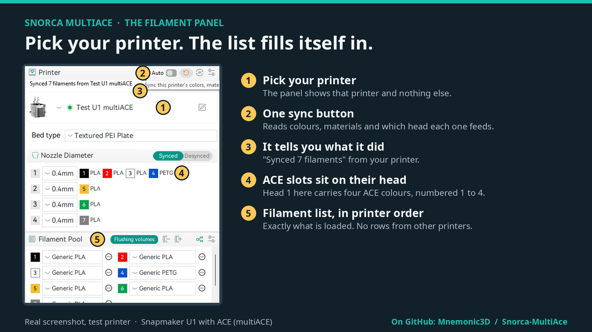
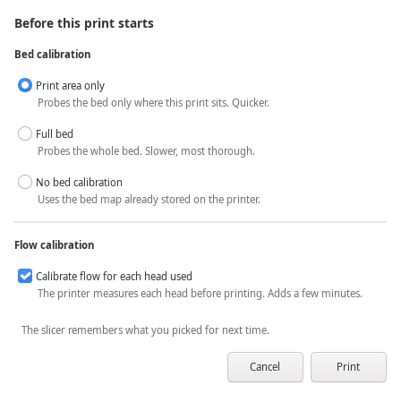
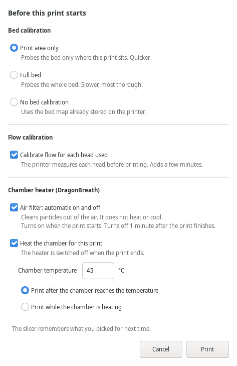
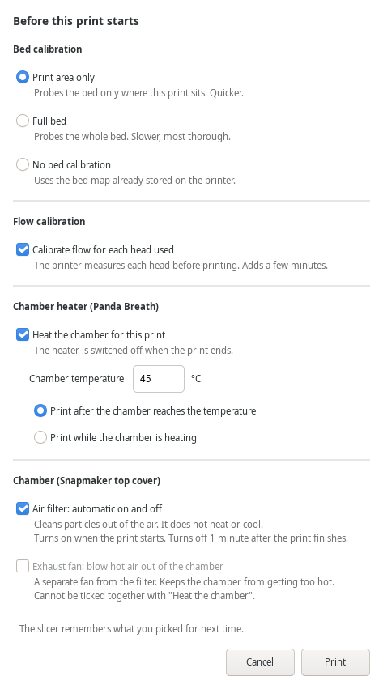
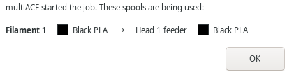
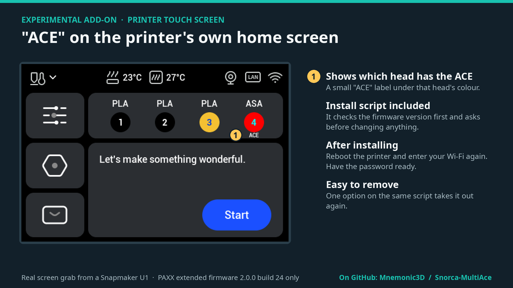
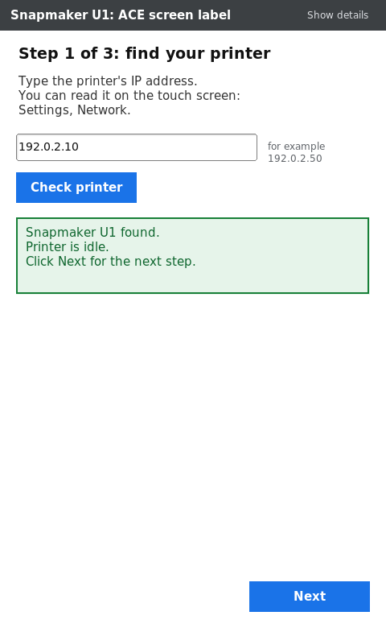
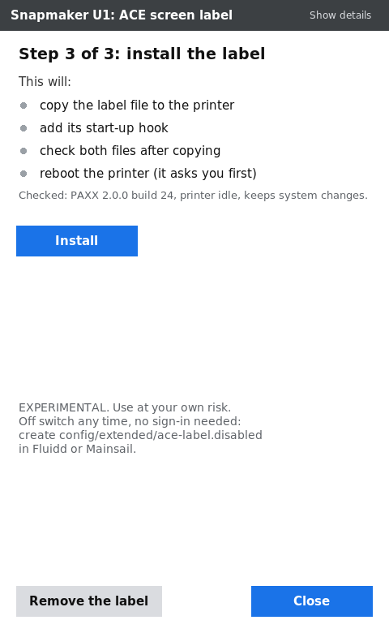

# Snorca MultiAce

**A custom fork of the Snapmaker Orca slicer, for the Snapmaker U1 with the multiACE add-on.**

It makes ACE colour printing on the U1 simple: pick your printer, the slicer reads what is loaded, and Print does the rest.

> **This is a community fork by Mnemonic3D.** It is not made or supported by Snapmaker, OrcaSlicer, FOrcaSlicer or the multiACE project. It is a test release: free, open source, use at your own risk.

**[Download (Linux and Windows)](https://github.com/Mnemonic3D/Snorca-MultiAce/releases)** · **[Watch the 2½-minute tour](https://youtu.be/1fYa3H8Mst8)** · **[Report a problem](https://github.com/Mnemonic3D/Snorca-MultiAce/issues)**

**Get the updates as they come:** star and watch this repository, and follow and like [Mnemonic ThreeDs on Facebook](https://www.facebook.com/profile.php?id=61565356706003) and [Mnemonic3D on YouTube](https://youtube.com/@Mnemonic3D).

---

## What it does

### 1. Pick your printer. The filament list fills itself in.

No more building the list by hand, and no rows left over from your other printers.

### 2. Press Print. Choose bed and flow calibration in one window.

Print area only, full bed, or no bed calibration. Flow calibration on or off. It remembers what you picked.

### 3. Chamber heater and top cover in the same window.

If your printer has a chamber heater (Panda Breath or DragonBreath), the window asks whether to heat the chamber, to what temperature, and whether to wait for it before printing. The heater switches off when the print ends.

With the Snapmaker top cover you also get the air filter (on when the print starts, off 1 minute after it finishes) and the exhaust fan. On a DragonBreath the filter and the heat can run together. The slicer only shows what your printer reports, and it remembers what you picked.

### 4. The filament list keeps up by itself.

With Auto sync on, switching printers refreshes the list on its own. If your objects use a filament the new printer does not have, they move to the same material in the closest colour, and one line tells you what moved. Edit > Undo puts the objects and the list back.

### 5. A clear answer after you press Print, on every print.

Every print on a multiACE printer opens the Print window and goes through multiACE, also a job with one filament on a normally fed head. Afterwards you see which printer is printing and which spool feeds each colour. If a job cannot start, it says why in plain words.

### 6. Optional: "ACE" on the printer's touch screen.

A small separate patch for the printer. Experimental. The slicer works without it.

**New: an installer with a window.** No firmware update and no command line. Download the installer for Windows or Linux, start it, type your printer's IP address and follow three steps: find your printer, sign in, install.

 

- It checks that the printer is a U1, is idle and runs the right firmware before it changes anything.
- If the printer does not keep system changes yet, it tells you, unlocks it for you and waits while the printer reboots.
- It copies the two label files, checks them and asks before it reboots the printer.
- "Remove the label" takes it off again.
- Your printer password is used for the sign-in only. It is not saved and goes nowhere but your printer.

You need SSH switched on in the PAXX extended firmware settings and the printer's root password.

---

## What you need

| | |
|---|---|
| **Printer** | Snapmaker U1 |
| **Printer firmware** | [PAXX extended firmware](https://github.com/paxx12-snapmaker-u1/SnapmakerU1-Extended-Firmware) 2.0.0, build 24 |
| **multiACE add-on** | [multiACE](https://github.com/decay71/multiACE) 1.27b |

Those two projects are made by other people; follow their instructions to install them. Without multiACE the slicer still works and prints the normal way.

## Download

Get the files from the **[Releases page](https://github.com/Mnemonic3D/Snorca-MultiAce/releases)**.

| System | What to download |
|---|---|
| **Linux** (64-bit) | The `...linux-x86_64.tar.xz` file. Unpack it and run `AppRun`. |
| **Windows** (64-bit) | The installer `.exe` or the portable `.zip`. New and lightly tested; Windows shows an "unknown publisher" warning. |
| **Mac** | Not planned for now. |
| **Touch-screen label installer** (optional) | Windows: the `...ACE-screen-label-installer-EXPERIMENTAL-windows-x64.exe` file. Linux: the `...ACE-screen-label-installer-EXPERIMENTAL-linux-x64` file; make it executable (`chmod +x`) and run it. One file, nothing to install on your PC. Windows shows an "unknown publisher" warning. |

## Where it stands

- **Test release.** Tried on two real U1 printers and on a simulated printer. Expect rough edges.
- **snorca.3** (chamber options, automatic filament move, Print window on every print) was tried by the author on his own printer on Linux. A full print with the DragonBreath filter and heat on together has not been run yet.
- **Windows** has only been tried in a Windows 11 test machine, not on a real printer. The newest Windows files (snorca.3) have not been run by us.
- **More than one ACE at once** is written for but only tested with one.
- **The touch-screen label installer** was run by the author from Linux on one of his own printers, which was already unlocked. The unlock step and the Windows program have only been run against a simulated printer (Windows in a Windows 11 test machine).
- Some screens in other languages still show the old name.

<b>Full list of changes from the stock slicer</b>

| | Stock slicer | Snorca MultiAce |
|---|---|---|
| **Filament list** | You set it up by hand, and filaments from your other printers get mixed in. | Pick your printer and the list fills itself in, in the printer's own order. |
| **Switching printers** | Old rows stay behind and pile up. | The list changes with the printer. |
| **Getting the list back** | Rebuild it by hand. | One click on the sync button. Painted objects move to the same material in the closest colour. |
| **Printing ACE colours** | The print window only knows four heads, so two colours can land on the same slot. | Press Print. It spots an ACE job, sends it to multiACE and starts the print. |
| **Picking spools** | You match them yourself on the printer. | Material must match exactly; colour picks the closest and tells you when it is not exact. |
| **Bed and flow calibration** | The ACE path had no way to ask. | Pick them when you press Print. *(new in snorca.2)* |
| **Chamber heater and top cover** | No chamber choices when you press Print. | Pick heat, temperature, wait, air filter and exhaust fan when you press Print. Only what your printer reports is shown. *(new in snorca.3)* |
| **Auto sync and your objects** | Objects keep filaments the printer does not have. | They move to the same material in the closest colour; Edit > Undo goes back. *(new in snorca.3)* |
| **Jobs with no ACE colours** | Went to the stock print window. | Every job on a multiACE printer gets the same Print window and goes through multiACE. *(new in snorca.3)* |
| **After you press Print** | No clear answer. | A window says "Printing on your printer" with each colour, its name and its ACE slot. |
| **When a job can't start** | An unclear error. | A plain reason, what the job needs next to what is loaded, and a button that opens the multiACE page. |
| **Saving settings** | Some line-width and speed boxes do not save. | Every one of those boxes saves into your own profile. |
| **Sending a job** | Could crash the slicer now and then. | Fixed. |

**Fixed in snorca.2:** in snorca.1, every ACE job started from Print ran with bed and flow calibration switched off. If you use snorca.1 for ACE prints, update.

<b>For developers: source and building</b>

This repository holds the full source: upstream FOrcaSlicer v2.3.2-fos.8.6.8 (commit `0b1f80cd22793785d8ae5c4296d2fe4a9248bd21` of [jiyang1018/FOrcaSlicer](https://github.com/jiyang1018/FOrcaSlicer)) with the Snorca MultiAce changes on top. The upstream build instructions are in [README-FOrcaSlicer-upstream.md](README-FOrcaSlicer-upstream.md). The Windows and Linux builds run on GitHub's machines from `.github/workflows/` and start only when someone presses "Run workflow".

The touch-screen label installer is in [`ace-label-installer/`](ace-label-installer/): Go with an FLTK window, built by the scripts in its `build/` folder.

## Credits and licence

Built on the work of the OrcaSlicer, Snapmaker Orca and FOrcaSlicer projects, the multiACE add-on, and the PAXX extended firmware for the Snapmaker U1. Thank you to their makers.

Open source, under the same licence as the slicer it is built on. Anyone may use and modify it.
